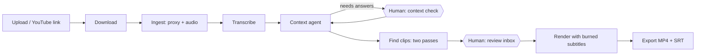

# Digestor

Digestor turns long videos (interviews, panels, hearings) into short, subtitled clips. Upload a file or paste a YouTube link, tell the app a little about the video, review the clips an AI proposes, and export the ones you approve as MP4 plus SRT.

## Problem

Long political and interview videos hide a few minutes that matter: a heated exchange, a key argument, a light moment. Finding them means scrubbing through hours of footage, then cutting and subtitling by hand. Digestor does the first pass: it transcribes the video, understands who is speaking and what the event is, proposes clips with cuts that never start or end mid-sentence, and leaves the final judgement to a human.

## How it works



1. **Intake:** an uploaded file (mp4, mov, mkv, webm) or a YouTube link (downloaded with yt-dlp).
2. **Ingest and transcribe:** ffmpeg makes a 480p proxy and extracts audio; AssemblyAI returns a word-timed transcript in the spoken language.
3. **Context agent:** Claude extracts event type, participants and topic, each fact tagged with its source (`video`, `metadata`, `human`); anything unsupported stays `null`. If it is unsure it asks up to 3 questions (one follow-up round at most). **Pause 1:** the human answers or skips.
4. **Clip finder:** pass one proposes long clips (target 2-12 min), pass two proposes short "hot takes" inside them. Every boundary is snapped to a pause or sentence end.
5. **Review inbox:** **Pause 2:** triage with the keyboard (`A` approve, `N` neutral, `R` reject, `E` edit times, arrows to move) and optionally adjust times.
6. **Render:** ffmpeg cuts each approved clip from the original with subtitles burned in (Noto Sans) and writes a sidecar `.srt`.

Progress streams to the browser over SSE; the pipeline survives worker restarts because it resumes from a Postgres checkpoint.

## Where the AI tooling lives

| Technique | Where |
| --- | --- |
| LangGraph `StateGraph`, `interrupt()` / `Command`, Postgres checkpointer | `apps/worker/src/pipeline/graph.ts` (checkpointer wired in `apps/worker/src/main.ts`) |
| LangChain `ChatAnthropic.withStructuredOutput` + zod | `apps/worker/src/llm/structured.ts` |
| Prompt engineering and grounding (fact sources, few-shot for interviews) | `apps/worker/src/agents/context.ts`, `apps/worker/src/agents/clips.ts` |
| Whisper-style speech-to-text via AssemblyAI | `apps/worker/src/transcribe/assemblyai.ts` |
| ChromaDB, RAG copilot, function calling | Plan 2 (coming) |

## Architecture

```
apps/web      Next.js app: screens (Upload, Processing, Context check, Review, Export) and API routes
apps/worker   Node worker: job queue consumer, LangGraph pipeline, ffmpeg, yt-dlp, AssemblyAI, Claude
packages/core Shared schemas, time/snap helpers, Drizzle tables, repo functions, LocalStorage
docker/initdb Creates the digestor_test database
data/         Uploaded and generated files (git-ignored)
```

- Docker Compose runs `postgres`, `chroma` (reserved for Plan 2) and `worker`. The web app runs on the host.
- Files live under `data/<sessionId>/` (for example `original.mp4`, `proxy.mp4`, `thumbs/<clipId>.jpg`, `clips/<clipId>.mp4` and `.srt`). The database stores these storage-relative keys, never absolute paths.
- The worker image already includes ffmpeg, yt-dlp and the Noto fonts; nothing to install on the host.

## Local setup

Prerequisites (one-time, macOS):

1. `brew install colima docker docker-compose`
2. Add `"cliPluginsExtraDirs": ["/opt/homebrew/lib/docker/cli-plugins"]` to `~/.docker/config.json`.
3. `colima start --cpu 4 --memory 8`, then check `docker compose version`.
4. Node 22 and pnpm via corepack (`corepack enable`). If corepack fails its signature check, run `npm i -g corepack@latest`.

Configure `.env` (`cp .env.example .env`):

| Key | Purpose |
| --- | --- |
| `ANTHROPIC_API_KEY` | Claude (context agent, clip finder) |
| `ASSEMBLYAI_API_KEY` | Transcription |
| `APP_PASSWORD` | Optional; leave empty to disable the password gate |
| `MAX_UPLOAD_GB` | Upload size limit (default 5) |
| `RETENTION_DAYS` | How long files are kept (default 7) |

Then:

```
docker compose up -d --build   # postgres, chroma, worker
pnpm install
pnpm db:migrate
pnpm --filter @digestor/web dev
```

Open http://localhost:3000. A manual end-to-end checklist is in `scripts/smoke.md`.

Never install ffmpeg or yt-dlp on the host; they run inside the worker container.

Notes:
- `docker/initdb` (creates `digestor_test`) only runs when the postgres volume is first created.
- The worker entrypoint runs `pnpm install --frozen-lockfile` on every start, so the `node_modules` volumes stay in sync after dependency changes.

### YouTube

Downloads work best from a home connection. From a server IP YouTube often asks for a bot check; the download is then best-effort and fails with a clear message ("download the video yourself and upload the file instead"). Digestor is for personal use, and you are responsible for how you use and share downloaded clips.

## Tests

- `pnpm test` runs host-safe packages (core, web).
- `pnpm test:worker` runs worker tests inside the container (ffmpeg, yt-dlp, fonts).
- `pnpm test:all` runs both.

## Roadmap

- Plan 2: heat timeline and trim handles, a Chroma-backed RAG copilot with function calling, speaker labels, evaluation of clip quality.
- Deployment to a single VPS (Task 18).

## Showcase

[Capstone showcase](https://showcase.turingcollege.com/…) (TODO: add the real link)
