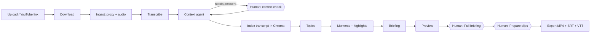

# Digestor

Digestor turns long videos (interviews, panels, hearings) into short, subtitled clips. Upload a file or paste a YouTube link, tell the app a little about the video, read an AI briefing with its highlights, pick the moments you want, trim and subtitle them, and export clips as MP4 plus SRT and WebVTT.

## Problem

Long political and interview videos hide a few minutes that matter: a heated exchange, a key argument, a light moment. Finding them means scrubbing through hours of footage, then cutting and subtitling by hand. Digestor does the first pass: it transcribes the video, understands what kind of event it is, splits it into topics, finds moments at three scales (exchange, passage, punchline), writes a grounded briefing, and leaves the final judgement to a human. Cuts never start or end mid-sentence.

## How it works



The stepper reads Upload › Processing › Context › Preview › Briefing › Prepare › Export.

1. **Intake:** an uploaded file (video or audio) or a YouTube link (downloaded with yt-dlp).
2. **Ingest and transcribe:** ffmpeg makes a 480p proxy and extracts audio; AssemblyAI returns a word-timed transcript in the spoken language.
3. **Context agent:** Claude extracts the profile (Parliament, Supreme court, Electoral debate, Trial / hearing, Interview, UN session, Other), participants and topic, each fact tagged with its source ("from video", "from metadata", "from you", "suggested by AI", or "missing"). If it is unsure it asks up to 3 questions. **Pause:** the human answers or skips.
4. **Analysis:** the transcript is indexed in Chroma (local multilingual embeddings); Claude finds topics, then moments per granularity with profile-specific highlight types (AI-judged ones carry an "AI" badge and a "Why:" line; counted ones say "counted"), then writes a briefing whose quotes are checked against the transcript. Every boundary is snapped to a sentence edge. Each analysis is a version; "Something's off" re-runs it.
5. **Preview:** a session timeline, top highlights and the briefing document.
6. **Full briefing:** instant filters (granularity, speaker focus, relevance, highlight type) and keyboard triage (`A` approve, `N` neutral, `R` reject, `E` open in Prepare, arrows to move). Approved moments are never hidden by filters. "Confirm selection → Prepare clips".
7. **Prepare clips:** trim on a sentence-snapped strip, checks ("The argument continues", "Context:", "Quoting someone else", "Interpreter audio"), 16:9 or 9:16 with a crop offset, a credit line, and per-language subtitles (translated by Claude, editable, approved before burn-in).
8. **Export:** ffmpeg cuts each ready clip from the original (H.264, optional burned-in subtitles in Noto Sans, a credit line drawn bottom-right) and offers MP4, SRT and VTT downloads.
9. **Ask** (press `/` on Preview or Full briefing): a RAG copilot answering only from the video's stored data, with function calls that change your personal selections (undoable; bulk changes need confirmation).

Progress streams to the browser over SSE; the pipeline survives worker restarts because it resumes from a Postgres checkpoint.

## Where the AI tooling lives

| Technique | Where |
| --- | --- |
| LangGraph `StateGraph`, `interrupt()` / `Command`, Postgres checkpointer | `apps/worker/src/pipeline/graph.ts` (checkpointer wired in `apps/worker/src/main.ts`) |
| LangChain `ChatAnthropic.withStructuredOutput` + zod | `apps/worker/src/llm/structured.ts` |
| Swappable LLM provider (Anthropic or OpenRouter via `ChatOpenAICompletions`) | `apps/worker/src/llm/provider.ts`, `apps/worker/src/llm/openrouter.ts` |
| Prompt engineering and grounding (fact sources, verbatim-quote check, per-item degradation) | `apps/worker/src/agents/` (context, topics, moments, briefing, checks, translation) |
| Whisper-style speech-to-text via AssemblyAI | `apps/worker/src/transcribe/assemblyai.ts` |
| ChromaDB transcript index, local e5 embeddings | `apps/worker/src/search/` |
| RAG copilot with function calling (Ask) | `apps/worker/src/agents/ask.ts`, `apps/web/components/Ask/` |
| Evaluation against a golden set | `apps/worker/src/eval/metrics.ts`, `apps/worker/scripts/eval.ts` |

## Architecture

```
apps/web      Next.js app: screens (Upload, Processing, Context check, Preview, Full briefing, Prepare, Export, Reports) and API routes
apps/worker   Node worker: job queue consumer, LangGraph pipeline, ffmpeg, yt-dlp, AssemblyAI, Claude
packages/core Shared schemas, time/snap helpers, Drizzle tables, repo functions, LocalStorage
docker/initdb Creates the digestor_test database
data/         Uploaded and generated files (git-ignored)
```

- Docker Compose runs `postgres`, `chroma` (the Ask transcript index) and `worker`. The web app runs on the host in development; in production it runs in its own container behind Caddy (see [Deployment](#deployment)).
- Files live under `data/<sessionId>/` (for example `original.mp4`, `proxy.mp4`, `thumbs/<clipId>.jpg`, `clips/<clipId>.mp4` and burned-in versions; SRT/VTT are rendered from the subtitle cues on each download). The database stores these storage-relative keys, never absolute paths.
- The worker image already includes ffmpeg, yt-dlp and the Noto fonts; nothing to install on the host.

## Local setup

Prerequisites (one-time, macOS):

1. `brew install colima docker docker-compose`
2. Add `"cliPluginsExtraDirs": ["/opt/homebrew/lib/docker/cli-plugins"]` to `~/.docker/config.json`.
3. `colima start --cpu 4 --memory 8`, then check `docker compose version`.
4. Node 22 and pnpm via corepack (`corepack enable`). If corepack fails its signature check, run `npm i -g corepack@latest`.

Configure `.env` (`cp .env.example .env`):

| Key | Purpose |
| --- | --- |
| `ANTHROPIC_API_KEY` | Claude (context, topics, moments, briefing, checks, translation, Ask) |
| `ASSEMBLYAI_API_KEY` | Transcription |
| `LLM_PROVIDER` | `anthropic` (default) or `openrouter`. Transcription always uses AssemblyAI |
| `OPENROUTER_API_KEY` | Needed only with `LLM_PROVIDER=openrouter` (replaces `ANTHROPIC_API_KEY`) |
| `OPENROUTER_MODEL_REASONING`, `OPENROUTER_MODEL_FAST` | Optional OpenRouter model ids; blank = `anthropic/claude-sonnet-5.5` and `anthropic/claude-haiku-5.5` |
| `APP_PASSWORD` | Optional; leave empty to disable the password gate |
| `MAX_UPLOAD_GB` | Upload size limit (default 5) |
| `VIDEO_RETENTION_DAYS` | How long the source video is kept (default 14): `original.*`, `audio.mp3`, `proxy.mp4` and the pipeline checkpoint are deleted; analyses, selections and rendered clips stay |

Then:

```
docker compose up -d --build   # postgres, chroma, worker
pnpm install
pnpm db:migrate
pnpm --filter @digestor/web dev
```

Open http://localhost:3000. A manual end-to-end checklist is in `scripts/smoke.md`. Without API keys the app still starts: anything AI fails with a friendly "… is not set on the server." message, while cutting and rendering keep working.

Never install ffmpeg or yt-dlp on the host; they run inside the worker container.

Notes:
- `docker/initdb` (creates `digestor_test`) only runs when the postgres volume is first created.
- The worker entrypoint runs `pnpm install --frozen-lockfile` on every start, so the `node_modules` volumes stay in sync after dependency changes.

### YouTube

Downloads work best from a home connection. From a server IP YouTube often asks for a bot check; the download is then best-effort and fails with a clear message ("download the video yourself and upload the file instead"). Digestor is for personal use, and you are responsible for how you use and share downloaded clips.

## Deployment

Production runs on a single VPS with `docker compose -f docker-compose.yml -f docker-compose.prod.yml up -d --build` (production images, Caddy with automatic HTTPS, migrations on start, daily removal of source videos older than `VIDEO_RETENTION_DAYS`). The step-by-step runbook (server, DNS, firewall, `.env`, logs, updates, backups) is in [`docs/deploy.md`](docs/deploy.md).

## Tests

- `pnpm test` runs host-safe packages (core, web).
- `pnpm test:worker` runs worker tests inside the container (ffmpeg, yt-dlp, fonts).
- `pnpm test:all` runs both.

## Evaluation

`apps/worker/scripts/eval.ts` compares an already-analysed session with a hand-labelled golden file and prints a Markdown table. It reads the database only and never calls the LLM. It reports:

- topic boundary error (mean and max, to the nearest found boundary);
- moment recall per granularity (a golden moment counts as found at 50% overlap);
- highlight-type matches;
- how many hand-made traps fired a check warning (a clip cut mid-argument, a quoted opponent).

```
docker compose exec worker pnpm --filter @digestor/worker exec tsx scripts/eval.ts <sessionId> <golden.json>
```

The golden path is relative to `apps/worker` (for example `test/fixtures/golden-sample.json`); the session id can also sit in the golden file. Run it in the worker container, which has the database URL. The format is in `apps/worker/src/eval/metrics.ts`.

**Comparing models.** Each analysis version records the model per step (`analysis_versions.models`; OpenRouter ids carry an `openrouter:` prefix). To compare models on the same video: set `LLM_PROVIDER=openrouter` and `OPENROUTER_MODEL_REASONING` / `OPENROUTER_MODEL_FAST` in `.env`, `docker compose up -d worker` (a restart alone doesn't re-read `.env`), click "Something's off" on the session to re-analyse it, and run the eval script again. The script scores the current version, so run it after each re-analysis. The transcript and context check are shared, so only the analysis models differ.

**Results: pending.** The real numbers wait for the owner's hand-labelled golden set (one ~1 h interview and one Câmara or Senado session; open input #2 in `docs/superpowers/plans/2026-10-30-plan-2-open-inputs.md`). The bundled `apps/worker/test/fixtures/golden-sample.json` is synthetic and only exercises the script against the seeded demo session; its numbers mean nothing. Attribution accuracy (speaker names) comes with Plan 3.

## Backlog from Plan 1

Carried over from the Plan 1 review ledger, still open (all small):

- **Language override:** let the user pick the transcription language instead of auto-detection.
- **Hardening:** `COPY . .` before install in the prod image and a root user; a yt-dlp binary checksum; `.dockerignore` patterns that only match at the repo root; default Postgres credentials in the prod compose file.
- **Upload robustness:** zero-byte uploads are accepted; an upload or YouTube request can leave an orphan file or row if creating the session or sending the job fails; the login comparison is not constant-time and has no throttle.
- **Pipeline polish:** the checkpoint for an interrupted job waits up to the job expiry before a retry; thumbnails are orphaned if analysis re-runs; no CHECK constraints on enum columns or indexes on foreign keys.
- **Text edge cases:** subtitle line wrapping for very long CJK words and Latin-after-CJK spacing; timestamp parsing accepts `99:99:99`.
- **Context screen:** "other" questions collapse into one.

Already handled in Plan 2: lenient LLM output schemas, a sweep for sessions stuck after a final-attempt crash, UTF-8 download filenames (`filename*`), a yt-dlp size cap and live-stream filter, the dismissible context banner. The out-of-bounds hot-take detach is obsolete (the clip finder was replaced by moments).

## Roadmap

- Plan 3: the person registry, speaker names with sources, attribution from captions and official records.
- Plan 4: Câmara and Senado connectors, the Tracker home, presence and participation tables.

## Showcase

[Capstone showcase](https://showcase.turingcollege.com/…) (TODO: add the real link)
