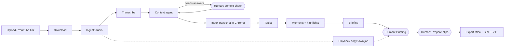

# Digestor

Digestor turns long videos (interviews, panels, hearings) into short, subtitled clips. Upload a file or paste a YouTube link, tell the app a little about the video, read an AI briefing with its highlights, pick the moments you want, trim and subtitle them, and export clips as MP4 plus SRT and WebVTT.

## Problem

Long political and interview videos hide a few minutes that matter: a heated exchange, a key argument, a light moment. Finding them means scrubbing through hours of footage, then cutting and subtitling by hand. Digestor does the first pass: it transcribes the video, understands what kind of event it is, splits it into topics, finds moments at three scales (exchange, passage, punchline), writes a grounded briefing, and leaves the final judgement to a human. Cuts never start or end mid-sentence.

## How it works



The stepper reads Upload › Processing › Context › Briefing › Prepare › Export.

1. **Intake:** an uploaded file (video or audio) or a YouTube link (downloaded with yt-dlp).
2. **Ingest and transcribe:** ffmpeg extracts the audio and AssemblyAI returns a word-timed transcript in the spoken language. The 480p playback copy is made in a separate job meanwhile: the context check plays voice samples from the audio, and the session becomes ready once both the analysis and the copy are done.
3. **Context agent:** Claude extracts the profile (Parliament, Supreme court, Electoral debate, Trial / hearing, Interview, UN session, Other), participants and topic, each fact tagged with its source ("from video", "from metadata", "from you", "suggested by AI", or "missing"). If it is unsure it asks up to 3 questions. **Pause:** the human answers or skips.
4. **Analysis:** the transcript is indexed in Chroma (local multilingual embeddings); Claude finds topics, then moments per granularity with profile-specific highlight types (AI-judged ones carry an "AI" badge and a "Why:" line; counted ones say "counted"), then writes a briefing whose quotes are checked against the transcript. Every boundary is snapped to a sentence edge. Each analysis is a version; "Something's off" re-runs it.
5. **Briefing:** one page at `/s/[id]` once the session is ready: a summary on top (what it is about, top highlights, the briefing text), then a card per topic with its moment tree. Instant filters (levels Exchanges / Passages / Punchlines, speaker focus, relevance, highlight type, status); each moment has Approve / Skip (click the active one again to undo it). Approved moments are never hidden by filters. "Prepare clips" confirms the selection.
6. **Prepare clips:** trim on a sentence-snapped strip that always shows where you are in time (hold Alt/Option for a free cut, saved as is with a "Cuts mid-sentence" warning), checks ("The argument continues", "Context:", "Quoting someone else", "Interpreter audio"), 16:9 or 9:16 with a crop offset, a credit line (typed once, it is remembered for the next clips), and per-language subtitles (translated by Claude, editable, approved before an MP4 with subtitles is made). The subtitle look (style and position) is chosen per clip with a preview. A "For all clips" panel sets the credit, the format or a subtitle language on every clip at once, after asking.
7. **Export:** ffmpeg cuts each ready clip from the original (H.264, a credit line drawn bottom-right). Each one offers MP4, SRT and VTT downloads, "MP4 with <language> subtitles" (the words in the picture, Noto Sans) and a Watch toggle that plays the rendered file inline. "Download all" makes one zip of what is already stored, with three choices: videos with subtitles, videos plus SRT/VTT files, or plain videos.
8. **Your sessions:** the home page lists your earlier sessions with their status, so you can pick up where you left off.
9. **Ask** (press `/` on the Briefing page): a RAG copilot answering only from the video's stored data, with function calls that change your personal selections (undoable; bulk changes need confirmation). It knows the speakers' names (confirmed or proposed) and can list when a named person speaks.
10. **Speaker names (Plan 3):** a registry of people, and a name for each voice with its source (the official Senado record, a caption on screen, the transcript, or you). Names from AI are proposals until you confirm them in Who's who; Prepare is blocked until the voices in a clip are confirmed or marked "No name"; sensitive profiles (a trial) never show an unconfirmed name. Results: the debate scores 0.99, the Senado plenary 0.93, a Bundestag debate 0.95 and a US House floor hour 0.85 (see Evaluation). Câmara plenary links are matched the same way; see the "Câmara record names" paragraph under Evaluation (matching validated on recorded text only, not yet scored on a golden file). "Report a problem" on a name goes to the reports list.

Progress streams to the browser over SSE; the pipeline survives worker restarts because it resumes from the step stored in Postgres.

## Where the AI tooling lives

| Technique | Where |
| --- | --- |
| Own step runner: Postgres-backed position (`pipeline_runs`), compare-and-set advance, one human pause | `apps/worker/src/pipeline/run.ts` |
| LangChain `ChatAnthropic.withStructuredOutput` + zod | `apps/worker/src/llm/structured.ts` |
| Swappable LLM provider (Anthropic or OpenRouter via `ChatOpenAICompletions`) | `apps/worker/src/llm/provider.ts`, `apps/worker/src/llm/openrouter.ts` |
| Prompt engineering and grounding (fact sources, verbatim-quote check, per-item degradation) | `apps/worker/src/agents/` (context, topics, moments, briefing, checks, translation) |
| Whisper-style speech-to-text via AssemblyAI | `apps/worker/src/transcribe/assemblyai.ts` |
| ChromaDB transcript index, local e5 embeddings | `apps/worker/src/search/` |
| RAG copilot with function calling (Ask) | `apps/worker/src/agents/ask.ts`, `apps/web/components/Ask/` |
| Evaluation against a golden set | `apps/worker/src/eval/metrics.ts`, `apps/worker/scripts/eval.ts` |

## Architecture

```
apps/web      Next.js app: screens (Upload, Processing, Context check, Briefing, Prepare, Export, Reports) and API routes
apps/worker   Node worker: job queue consumer, step-runner pipeline, ffmpeg, yt-dlp, AssemblyAI, Claude
packages/core Shared schemas, time/snap helpers, Drizzle tables, repo functions, LocalStorage
docker/initdb Creates the digestor_test database
data/         Uploaded and generated files (git-ignored)
```

- Docker Compose runs `postgres`, `chroma` (the Ask transcript index) and `worker`. The web app runs on the host in development; in production it runs in its own container behind Caddy (see [Deployment](#deployment)).
- Files live under `data/<sessionId>/` (for example `original.mp4`, `proxy.mp4`, `thumbs/<clipId>.jpg`, `clips/<clipId>.mp4` and burned-in versions; SRT/VTT are rendered from the subtitle cues on each download). The database stores these storage-relative keys, never absolute paths.
- The worker image already includes ffmpeg, yt-dlp and the Noto fonts; nothing to install on the host.

## Local setup

Prerequisites (one-time, macOS):

1. `brew install colima docker docker-compose`
2. Add `"cliPluginsExtraDirs": ["/opt/homebrew/lib/docker/cli-plugins"]` to `~/.docker/config.json`.
3. `colima start --cpu 4 --memory 8`, then check `docker compose version`.
4. Node 22 and pnpm via corepack (`corepack enable`). If corepack fails its signature check, run `npm i -g corepack@latest`.

Configure `.env` (`cp .env.example .env`):

| Key | Purpose |
| --- | --- |
| `ANTHROPIC_API_KEY` | Claude (context, topics, moments, briefing, checks, translation, Ask) |
| `ASSEMBLYAI_API_KEY` | Transcription |
| `LLM_PROVIDER` | `anthropic` (default) or `openrouter`. Transcription always uses AssemblyAI |
| `OPENROUTER_API_KEY` | Needed only with `LLM_PROVIDER=openrouter` (replaces `ANTHROPIC_API_KEY`) |
| `OPENROUTER_MODEL_REASONING`, `OPENROUTER_MODEL_FAST` | Optional OpenRouter model ids; blank = `anthropic/claude-sonnet-5.5` and `anthropic/claude-haiku-5.5` |
| `APP_PASSWORD` | Optional; leave empty to disable the password gate |
| `MAX_UPLOAD_GB` | Upload size limit (default 5) |
| `VIDEO_RETENTION_DAYS` | How long the source video is kept (default 14): `original.*`, `audio.mp3`, `proxy.mp4` and the pipeline checkpoint are deleted; analyses, selections and rendered clips stay |

Then:

```
docker compose up -d --build   # postgres, chroma, worker
pnpm install
pnpm db:migrate
pnpm --filter @digestor/web dev
```

Open http://localhost:3000. A manual end-to-end checklist is in `scripts/smoke.md`. Without API keys the app still starts: anything AI fails with a friendly "… is not set on the server." message, while cutting and rendering keep working.

Never install ffmpeg or yt-dlp on the host; they run inside the worker container.

Notes:
- `docker/initdb` (creates `digestor_test`) only runs when the postgres volume is first created.
- The worker entrypoint runs `pnpm install --frozen-lockfile` on every start, so the `node_modules` volumes stay in sync after dependency changes.

### YouTube

Downloads work best from a home connection. From a server IP YouTube often asks for a bot check; without cookies the download then fails with a clear message ("download the video yourself and upload the file instead"). To get past it, give the worker a logged-in session's cookies (`YTDLP_COOKIES_FILE`, see [docs/deploy.md](docs/deploy.md#youtube-links-on-a-server)). Digestor is for personal use, and you are responsible for how you use and share downloaded clips.

## Deployment

Production runs on a single VPS with `docker compose -f docker-compose.yml -f docker-compose.prod.yml up -d --build` (production images, Caddy with automatic HTTPS, migrations on start, daily removal of source videos older than `VIDEO_RETENTION_DAYS`). The step-by-step runbook (server, DNS, firewall, `.env`, logs, updates, backups) is in [`docs/deploy.md`](docs/deploy.md).

## Tests

- `pnpm test` runs host-safe packages (core, web).
- `pnpm test:worker` runs worker tests inside the container (ffmpeg, yt-dlp, fonts).
- `pnpm test:all` runs both.

## Evaluation

`apps/worker/scripts/eval.ts` compares one analysis version of a session with a hand-labelled golden file and prints a Markdown table. Without `--run-checks` it reads the database only and never calls the LLM. It reports:

- topic boundary error (mean and max, to the nearest found boundary);
- moment recall per granularity (a golden moment counts as found at 50% overlap);
- highlight-type matches;
- how many hand-made traps fired a check warning, per kind (a clip cut mid-argument, a quoted opponent);
- how many moments the version found per granularity.

```
docker compose exec worker pnpm --filter @digestor/worker exec tsx scripts/eval.ts <sessionId> <golden.json> [--version N] [--run-checks]
```

`--version N` scores that complete version instead of the current one. Checks only run on demand in the app (when a moment is approved or a clip is made), so a trap overlapped only by unchecked moments can't fire; the table says how many were unchecked. `--run-checks` first checks those moments with the model the version recorded for checks and stores the result, as the app would.

The golden path is relative to `apps/worker` (for example `test/fixtures/golden-sample.json`); the session id can also sit in the golden file. Run it in the worker container, which has the database URL. The format is in `apps/worker/src/eval/metrics.ts`.

**Comparing models.** Each analysis version records the model per step (`analysis_versions.models`; OpenRouter ids carry an `openrouter:` prefix). To compare models on the same video: set `LLM_PROVIDER=openrouter` and `OPENROUTER_MODEL_REASONING` / `OPENROUTER_MODEL_FAST` in `.env`, `docker compose up -d worker` (a restart alone doesn't re-read `.env`), click "Something's off" on the session to re-analyse it, and run the eval script again with `--version` for each version. The transcript and context check are shared, so only the analysis models differ.

**Results (2026-11-02).** Video: the Globo presidential debate, Lula × Flávio Bolsonaro, 23 Oct 2026 (Portuguese, 1 h 57 min; session `7433d1c6`). Golden file: `apps/worker/eval/globo-debate-2026-10-23.golden.json`, with 15 topics, 14 exchanges, 31 passages, 26 punchlines, 68 typed highlights and 9 traps (5 quoted opponents, 4 cuts mid-argument). Claude drafted the labels from the AssemblyAI transcript and the owner reviewed and accepted them. Both versions share the same transcript and context card and differ only in the analysis model. Traps were scored with `--run-checks`.

| Metric | Claude Haiku 5.5 (v1) | GPT-6 Luna (v2) |
| --- | --- | --- |
| Topic boundary error, mean / max | 14.1 s / 43.5 s | 17.4 s / 106.8 s |
| Moment recall, exchange | 10/14 (71%) | 12/14 (86%) |
| Moment recall, passage | 26/31 (84%) | 22/31 (71%) |
| Moment recall, punchline | 17/26 (65%) | 16/26 (62%) |
| Highlight type matched | 44/68 | 43/68 |
| Check warnings on traps, mid-argument | 2/4 | 0/4 |
| Check warnings on traps, quoted opponent | 5/5 | 5/5 |
| Moments found (exchange / passage / punchline) | 25 / 86 / 84 | 17 / 52 / 66 |
| Median length (exchange / passage / punchline) | 164 / 37 / 16 s | 369 / 67 / 26 s |

The trap rows need a control, because a check that warns on everything would also score 5/5. Checking 19–24 moments well away from any trap gave these warning rates (trap-overlapping moments vs control):

| | Haiku: reported speech | Haiku: incomplete | Luna: reported speech | Luna: incomplete |
| --- | --- | --- | --- | --- |
| Overlaps a trap | 10/13 | 9/13 | 9/13 | 0/13 |
| Control | 3/19 | 7/19 | 3/24 | 3/24 |

The reported-speech check works on both models. Haiku's completeness check fires often everywhere, and Luna's almost never fires.

What the misses show:

- **Punchlines were capped at 4 per exchange.** The 6-minute Norte exchange alone holds 7 golden punchlines; "mordido por um carapanã" and "É você ou é o Google?" were lost on both models. Fixed since (below).
- **Punchlines only come from inside exchanges.** Haiku left 50:09–55:16 without an exchange. That stretch is the "9 dedos" (nine fingers) fight, the most quoted moment of the debate, and neither model has it as a punchline.
- **Haiku splits a round** (question → answer → rebuttal → counter-rebuttal) into 2–3 shorter exchanges, which costs exchange recall. Luna keeps whole rounds but finds a third fewer passages, so it misses the "9 dedos" passage too.
- Cost on OpenRouter: about $0.25 for both full analyses plus every check, against about $0.46 of AssemblyAI credit for transcribing 2 hours ($0.23 an hour: Universal-3.5 Pro plus speaker labels).

**After the first fixes (2026-11-02).** The punchline cap now grows with the exchange: one per 45 s, between 4 and 8 (`punchlineCap`), and the session cap rose from 200 to 250 moments. Two new Haiku runs on the same code (v3, v4) against the first Haiku run:

| Metric | Haiku v1 (cap 4) | Haiku v3 | Haiku v4 |
| --- | --- | --- | --- |
| Moment recall, exchange | 10/14 | 9/14 | 10/14 |
| Moment recall, passage | 26/31 | 20/31 | 26/31 |
| Moment recall, punchline | 17/26 | 18/26 | 16/26 |
| Golden punchlines inside a found exchange | 22/26 | 19/26 | 17/26 |
| … of those, found | 16/22 (73%) | 16/19 (84%) | 15/17 (88%) |
| Check warnings on traps, mid-argument / quoted opponent | 2/4 · 5/5 | 4/4 · 4/5 | 2/4 · 5/5 |
| Moments found (exchange / passage / punchline) | 25 / 86 / 84 | 22 / 86 / 112 | 23 / 89 / 103 |

Inside an exchange the fix works: long exchanges now get 6–8 punchlines and the hit rate rose from 73% to 84–88%. Overall punchline recall did not move, because a punchline can only be found inside an exchange, and how many golden punchlines the exchanges cover varies from run to run (17–22 of 26). Run-to-run noise is large in general: passage recall went from 20 to 26 between v3 and v4, with the same code and model. Single runs can't separate models that differ by a few moments.

**Punchlines between exchanges.** Each topic's stretches that no exchange covers (at least 30 s, split into windows of at most 6 min, at most 20 calls, longest first) now get their own punchline call; such a punchline nests under the passage it lies in, if any (`gapsBetween`, prompt `punchlines@2`). Two Haiku runs:

| Metric | Haiku v3 / v4 (exchanges only) | Haiku v5 | Haiku v6 |
| --- | --- | --- | --- |
| Moment recall, punchline | 18/26 · 16/26 | 18/26 | 21/26 |
| Punchlines found (of them between exchanges) | 112 · 103 | 143 (42) | 143 (25) |
| Moment recall, exchange / passage | 9 · 10 / 20 · 26 | 8/14 · 22/31 | 11/14 · 17/31 |
| Moments in total | 220 · 215 | 240 | 250 (the cap) |

Punchline recall rises from 16–18 to 18–21 of 26, and no golden punchline lies outside every call any more. The remaining misses are choices: of v5's 8, 6 sit inside an exchange and 2 in a gap window whose call picked a neighbouring line, and two overlap a found punchline by 36–45%, just under the 50% that counts. A run cost about $0.13–0.15 with or without the extra calls; the real cost is more punchlines to triage. v6 hit the 250-moment cap; it cut moments below relevance 35–40, which the briefing would list last anyway.

The context check also kept dropping a human answer: replaying the round-1 call six times, the model once quoted the answer loosely as evidence, and the verbatim check threw the correct date away, so the date question came back. Grounding now keeps a human-sourced value whose words appear in the human's answers, however the model quoted them. The eval doesn't cover this step (re-analysis reuses the context card); the replayed case is a unit test.

Cost of the replays, the four runs and their checks on OpenRouter: about $0.60.

**Câmara record names (2026-11-03).** A Câmara plenary link (`https://www.camara.leg.br/evento-legislativo/<id>`) works like a Senado date: the deputies who spoke get named. The Câmara API has no per-event speech list, so the list is built from the event's window: the event's deputies (one call) and each one's speeches of that day (one call per deputy, about 500 on a plenary, four at a time, under 3 minutes), keeping those whose 4-minute stenography stamp falls between the event's start and end (speeches sharing a stamp are ordered by the turn they match best). The match itself is the same as for the Senado. Not yet scored against a golden file.

**Speaker names from the Senado record (2026-11-03).** Golden files can carry `speakers` (who speaks when; the eval scores the share of that speaking time named correctly, wrongly or not at all, with `score = (correct − 5 × wrong) / total`). Video: the Senado plenary of 30 June 2026 from TV Senado (5 h 19 min, about 2 h 40 min of speech; session `f2fce3ea`), with the record of session 564622 linked at upload (22 speeches by 17 senators, all with full text). Golden file: `apps/worker/eval/senado-2026-06-30.golden.json`, 30 turns of 18 people (179 min), drafted by Claude from the transcript and the record text, and reviewed and accepted by the owner.

What AssemblyAI's diarization gave, with only `speaker_labels` set: 16 voices, 66 turns. Nearly every senator got a voice of their own, so 16 of the 17 senators landed on one voice each. The exception is the chair's voice (E), which also holds Hamilton Mourão's "pela ordem", Damares Alves and a TV Senado feature shown during the break. AssemblyAI can take the expected speaker count (`speakers_expected`, or `speaker_options` with a min and max); we don't send it yet. Here the record's 17 senators against 16 voices suggests it would change little.

| Metric (AI only) | First run | After the fix |
| --- | --- | --- |
| Speaking time named correctly | 7,268 s (93%) | 7,272 s (93%) |
| Speaking time named wrongly | 130 s (2%) | 0 s (0%) |
| Speaking time unnamed | 434 s (6%) | 559 s (7%) |
| Attribution score | 0.84 | 0.93 |

**The fix.** The record prints other people's turns inside a speech, each under its own header: the chair's reply sits inside Mourão's and Jayme Campos's speeches ("O SR. PRESIDENTE (Davi Alcolumbre…) –"). The matcher scored Davi's reply against the whole speech and named it after the senator: "Hamilton Mourão", confirmed at 0.83. No threshold could fix that, because correct matches scored 0.67–0.82. Matching now keeps only the parts headed by the speech's own speaker (`speechText`). With that, every match on this video is right, and the turns left unmatched score at most 0.19 against any speech, against 0.41 for the weakest right match. So the thresholds stay at `RECORD_PROPOSE` 0.35 and `RECORD_CONFIRM` 0.6. Matches between 0.41 and 0.51 (about 7 minutes, the chair's longer interventions) stay "proposed" for a human to confirm. The unnamed time is mostly the chair's short lines ("Com a palavra…"), which the record doesn't contain.

The debate (no record; names from the transcript and context check) still scores 0.99: 100% named correctly, 6.8 s wrong.

Cost of the Senado run: AssemblyAI, about $1.22 for 5.32 hours (Universal-3.5 Pro $0.21 + speaker labels $0.02 an hour, the model the transcript reports); OpenRouter (Claude Haiku 5.5, context check plus full analysis), at most $0.21. The Senado API is free. The 8 GB download and the 480p preview took 92 minutes before transcription started, because the preview copy is made first. Transcription itself took 6 minutes.

**Speaker names from the Bundestag and US House records (2026-11-04, Plan 4).** Two more houses, one video each, scored the same way. Golden files (drafted by Claude from the transcript and the record; owner review pending): `apps/worker/eval/bundestag-2026-10-16.golden.json` and `apps/worker/eval/us-house-2026-09-03.golden.json`.

- **Bundestag:** sitting 21/103 of 16 October 2026, TOP 34 "Bürokratierückbau im Verkehrsbereich" (32 min, official channel, session `b3e26a69`). The YouTube link was pasted with no record: the suggester read "103. Sitzung vom 16.10.2026" and proposed the right sitting, accepted at the context check. The Plenarprotokoll named all 9 speeches correctly (confidence 0.71–0.98) and fixed one name the transcript misheard ("Anja Tropschow-Harzig" is Anja Troff-Schaffarzyk). 20 turns of 10 people (the whole debate).
- **US House:** floor proceedings of 3 September 2026, first 65 minutes (one-minute speeches and the H.R. 4795 debate; session `a8037dcf`), uploaded as a file with the record linked by date. On the same video's YouTube details the suggester proposes the right day (US House Clerk channel). 33 turns of 16 people (the reading clerk counted as one).

| Metric (AI only) | Bundestag | US House |
| --- | --- | --- |
| Speaking time named correctly | 1,374 s (95%) | 1,552 s (94%) |
| Speaking time named wrongly | 0 s (0%) | 29 s (2%), of which 1.2 s confirmed |
| Speaking time unnamed | 66 s (5%) | 70 s (4%) |
| Attribution score | 0.95 | 0.85 |

**Thresholds.** The Bundestag keeps 0.6 / 0.35: its weakest right match is 0.71 and nothing is wrong. The US House confirms at **0.8**: there the reading clerk reading a bill title matches the bill sponsor's speech (0.78), and the chair's "the gentlewoman is recognized for 5 minutes" matches the member who yielded (0.71, 0.75). At 0.6 those would be confirmed wrongly (1.6% of speaking time, above the 1% target); at 0.8 they stay proposals for a human, and the only confirmed wrong name is 1.2 s (0.07%): Scott's "Mr. Speaker, I'm prepared to close", which the record prints only under Walberg. Both houses are now `evaluated: true` in `packages/core/src/chambers.ts`; the US Senate stays proposals-only until a Senate video is scored. The unnamed time is the chair: the Bundestag record names the presiding officer without an MdB id, and the US House chair's short lines are not in the record.

**Found on the way.** For a house that is not evaluated, the transcript's name ("Für die AfD-Fraktion erhält Wolfgang Wiehle das Wort") and the record's name for the same voice are two different person rows, so the voice shows a conflict instead of a name (before `evaluated: true` the Bundestag scored 0% named). Evaluated houses don't show it (a confirmed record name wins), but the US Senate still would: the record step should merge a transcript-proposed person with the official person of the same name. Cost of both runs: AssemblyAI about $0.37 for 1.6 hours; OpenRouter (Haiku 5.5) a few cents. Downloading only part of a YouTube video with yt-dlp (`--download-sections`) ran at about 3 MB a minute; the whole video at 480p took 3 minutes.

The bundled `apps/worker/test/fixtures/golden-sample.json` is synthetic and only exercises the script.

## Backlog from Plan 1

Carried over from the Plan 1 review ledger, still open (all small):

- **Pipeline polish:** the checkpoint for an interrupted job waits up to the job expiry before a retry; thumbnails are orphaned if analysis re-runs; no CHECK constraints on enum columns or indexes on foreign keys.
- **Text edge cases:** subtitle line wrapping for very long CJK words and Latin-after-CJK spacing.
- **Context screen:** "other" questions collapse into one.

Already handled in Plan 2: lenient LLM output schemas, a sweep for sessions stuck after a final-attempt crash, UTF-8 download filenames (`filename*`), a yt-dlp size cap and live-stream filter, the dismissible context banner. The out-of-bounds hot-take detach is obsolete (the clip finder was replaced by moments).

## Roadmap

- Plan 3 (done): the person registry, speaker names with sources, attribution from captions and official records.
- Plan 4 (done): official records for five houses (Câmara, Senado, Bundestag, US House, US Senate) by link, date or YouTube suggestion; records not yet published wait and are fetched again; Bundestag and US House scored on real videos.
- Plan 5: the Tracker for all three countries (everyone, with search; stable person records across elections and mandates).
- Later: elections data per country, presence and participation stats, judgement metrics, a word heat map, committee hearings.

## Showcase

[Capstone showcase](https://showcase.turingcollege.com/…) (TODO: add the real link)
